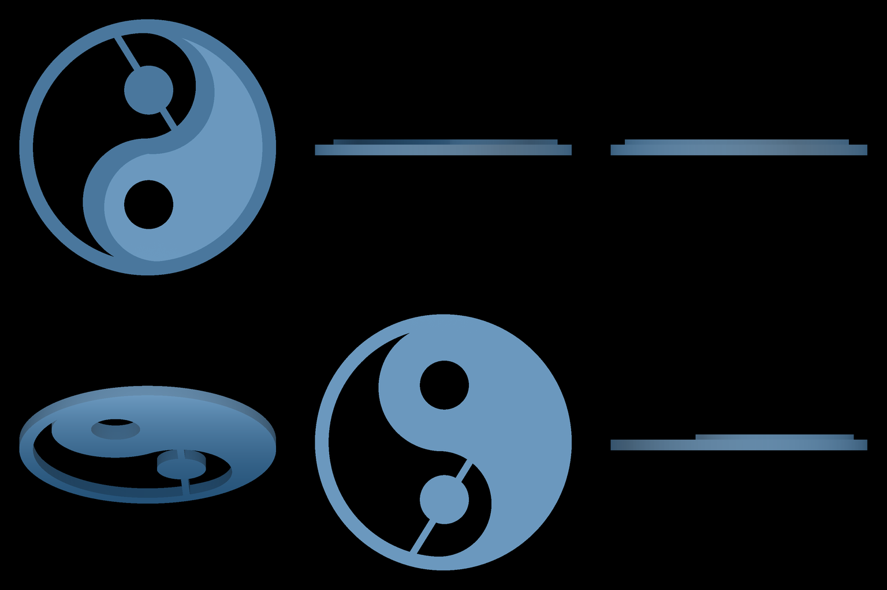
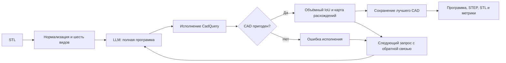
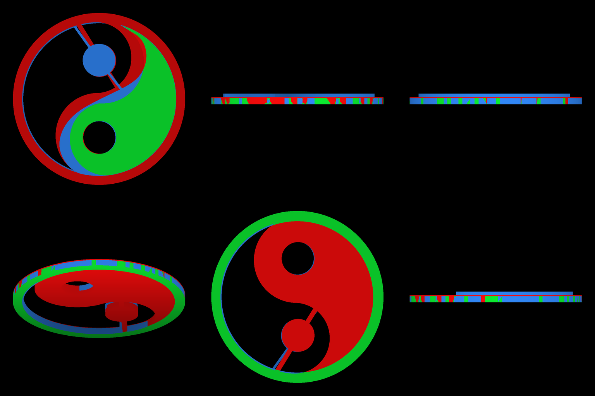
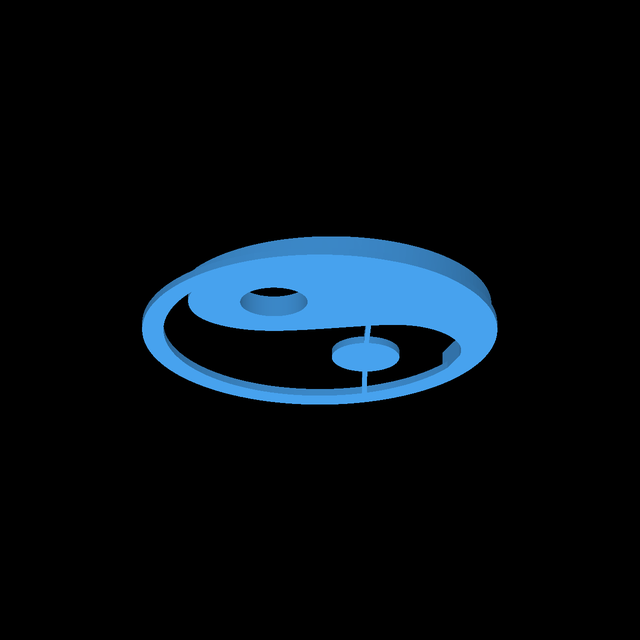

# Mesh2CAD: полный цикл реконструкции

Метод переводит треугольную сетку STL в исполняемую программу CadQuery. Harness
организует исполнение, измеряет ошибки и передаёт их модели для следующей попытки.
Параметры модели не изменяются. Геометрию уточняет сама модель, переписывая программу.

## 1. Исходные данные и единая система координат

На вход поступает STL одного объекта. В эксперименте используются два домена:
механические детали DeepCAD и предметы интерьера Interior300. До обращения к LLM
проверяются SHA-256 файла, конечность координат, наличие поверхности и корректный
замкнутый объём. Объекты, для которых объёмный IoU не определён, исключаются
до генерации, одинаково для всех сравниваемых условий.

Для bounding box с границами `b_min`, `b_max` вычисляем:

```text
center = (b_min + b_max) / 2
scale = max(b_max - b_min)
x_normalized = (x_source - center) / scale
x_source = scale * x_normalized + center
```

Таким образом, центр bounding box находится в начале координат, максимальный
габарит равен 1. Трансформация сохраняется в `normalization.json`. Предсказание
сразу должно находиться в этих координатах. Масштаб и положение результата
при оценке дополнительно не подгоняются.

## 2. Что именно видит модель

Основной эксперимент использует **classic harness**. Из нормализованного STL
детерминированно строится лист 1536 × 1024 пикселя, состоящий из шести видов
512 × 512. Порядок фиксирован:

| Ряд | Вид 1 | Вид 2 | Вид 3 |
|---|---|---|---|
| Верхний | top, со стороны +Z | left, со стороны −X | right, со стороны +X |
| Нижний | isometric, elevation −25°, azimuth −55° | bottom, со стороны −Z | front, со стороны −Y |

Каждый тайл объединяет RGB-рендер и карту глубины. Это ортографические виды
из известного STL. Отдельные фотографии и сканы данным экспериментом не проверяются.



Показан точный вход детали `3376e6b0a71b3a98` нового эксперимента.
Лист каждого объекта сохраняется в его каталоге `items/<id>/target.png`.

В первом запросе передаются базовый system prompt с контрактом CadQuery,
задача реконструкции, нормализованные габариты X/Y/Z и один лист видов.
Модель не получает исходные треугольники, исходный CAD-код или готовое решение.
У baseline «один промпт» нет предварительного вызова для анализа геометрии.

В проекте также есть отдельный depth-only оркестратор с анализом и измеренными
сечениями. Его результаты нельзя смешивать с данным трёхрежимным сравнением.

## 3. Что возвращает модель и что сохраняет система

Ответ имеет вид JSON с полем `code`. Это полная Python-программа, которая
импортирует `cadquery as cq` и создаёт итоговую модель в переменной `r`.
Например, программа для симметричной полой детали может строиться так:

```python
import cadquery as cq

width = 0.8
depth = 0.6
height = 1.0
hole_diameter = 0.2
r = cq.Workplane("XY").box(width, depth, height)
r = r.faces(">Z").workplane().hole(hole_diameter)
```

Это пример контракта, а не реконструкция показанного выше объекта. В реальной
программе модель выбирает эскизы, экструзии, вращения, булевы операции и размеры.

Код исполняется в отдельном ограниченном процессе. Система сохраняет программу,
STEP с CAD-геометрией и STL для сравнения. Редактируемое описание построения
находится в Python-коде; STEP сам по себе не обещает исходную историю операций.
Вместе с ними сохраняются точные запросы, ответы, stdout/stderr и JSON метрик.

## 4. Исполнение и измерение геометрической ошибки



Если код не исполнился, модель получает реальный traceback. Такая попытка
остаётся в журнале, учитывается в стоимости и расходует одну из пяти попыток.

Для пригодного результата вычисляется объёмный IoU полных STL:

```text
IoU = Volume(target ∩ candidate) / Volume(target ∪ candidate)
```

Пересечение и объединение строятся булевыми операциями manifold3d над сетками.
Это метрика тесселированной геометрии, а не сравнение картинок и не оценка
по bounding box. Кодировка silhouette/depth сама по себе не заменяет объёмный IoU.

## 5. Как модель уточняет геометрию

Для лучшей проверенной программы строится карта трёх объёмных областей:

| Цвет | Область | Как использовать при исправлении |
|---|---|---|
| Зелёный | `target ∩ candidate` | Сохранить совпавшую часть |
| Синий | `candidate − target` | Уменьшить размер, сдвинуть элемент или вычесть лишний материал |
| Красный | `target − candidate` | Добавить отсутствующий элемент, восстановить толщину или изменить положение |



Внутри каждого цвета яркость кодирует линейную глубину: светлее означает ближе.
Цвет обозначает тип области, а не величину ошибки. Near/far-плоскости каждого
вида фиксируются по исходнику, калибровка передаётся в запросе. Изображение
выше действительно передано модели при второй генерации для той же детали.
Точная карта каждой тестовой попытки сохраняется как `overlay-feedback-v<version>.png`.

В следующем запросе модель получает исходные виды и габариты, лучший код и его IoU,
карту расхождений лучшего результата и до трёх последних попыток с ошибками.
Численная missing surface дополнительно описывает долю размеченных граней
поверхности, центры которых дальше `0.015` нормализованных единиц от CAD.
Она зависит от порога и тесселяции и не является объёмной метрикой.

Например, красная полоса вдоль стенки и синяя полоса рядом с ней указывают
на неверное положение стенки. Красная область внутри отверстия может означать,
что модель вычла слишком много материала. Синие области внутри пустот исходника
могут требовать нового `cut` или изменения диаметра отверстия. Модель проверяет
эту интерпретацию по нескольким ракурсам и возвращает полную изменённую программу.
Harness исполняет её и заново измеряет IoU.

На показанной детали первый ответ Luna получил IoU **0.5129**. Модель изменила
высоту ободка с `0.004` до `−0.010`, опустила нижнюю границу рельефа до `zmin`
и уточнила внешнюю дугу. Лучшая, четвёртая попытка получила IoU **0.7380**.
Пятая дала **0.7163**, поэтому система сохранила четвёртую. Sol с одним
промптом получила на том же входе **0.9731**. Это один пример механизма,
а не средняя оценка домена.



Автоматического поиска параметров, ICP, изменения масштаба или переноса результата
после ответа LLM в этом цикле нет. Это итеративное программное исправление,
которое может менять и размеры, и структуру построения.

## 6. Выбор результата и остановка

После каждой пригодной попытки сохраняется программа с наибольшим IoU.
Более поздняя ошибка или ухудшение не заменяют лучший результат.

Для основного сравнения задано не более пяти генераций, целевой IoU 0.9,
patience 3 и минимальное значимое улучшение 0.001. Лимит на объект составляет
600 секунд, 100 000 суммарных токенов, 16 000 выходных токенов на ответ,
60 секунд на CadQuery и 2048 МиБ RSS на worker с дочерними процессами.
Остановка происходит при достижении цели, отсутствии значимого улучшения
или исчерпании лимита. Стоимость включает все вызовы, включая неудачные.
В пакетном эксперименте остановка watchdog во время исполнения CadQuery
записывается как ошибка этой попытки: baseline получает неудачный выход,
а harness может предложить более экономную конструкцию с тем же лимитом.
Сохранённый оплаченный ответ при этом не запрашивается повторно.

## 7. Как проверяется польза harness

На одних и тех же объектах отдельно в каждом домене сравниваются:

1. `openai/gpt-6-luna`, только первый ответ без обратной связи.
2. Та же первая программа `gpt-6-luna` и продолжение classic harness до пяти попыток.
3. `openai/gpt-6-sol`, один ответ без обратной связи.

Вход, базовый промпт, reasoning effort `medium`, лимит ответа и среда исполнения
совпадают. Первый ответ дешёвой модели разделяется между первым и вторым условиями:
это парное сравнение остановки после первого ответа с продолжением того же запуска.
Стоимость первой попытки входит в обе логические строки таблицы, но фактически
оплачивается один раз. Суммарный новый расход равен строкам «дешёвая + harness»
плюс «дорогая, один промпт».

Основная метрика - средний IoU по всем обработанным объектам когорты.
Для неудачной реконструкции в этом среднем используется 0. Дополнительно
показываются среднее и медиана среди оценённых CAD, доля исполнившихся программ,
доля пригодных объёмов, доля IoU ≥ 0.9, вызовы, токены, время и стоимость.
Незапущенные объекты не превращаются в измеренные нули.

Парные разности проверяются bootstrap по идентификаторам объектов
(20 000 выборок с возвращением, seed 42, percentile 95% CI). Интервал
описывает вариативность объектов этой локальной выборки. Один ответ на объект
не измеряет вариативность повторных генераций модели.

Текущие исходные данные и рассчитанные значения находятся в
[`benchmark/`](benchmark/).
Выборки по 50 объектов зафиксированы до новых генераций. При нехватке бюджета
берётся одинаковый по размеру префикс для всех трёх условий, а Interior300
чередует четыре IndoorCAD и один Poly Haven. Ограничение по ресурсам и фактическое
число объектов указываются вместе с результатами.
